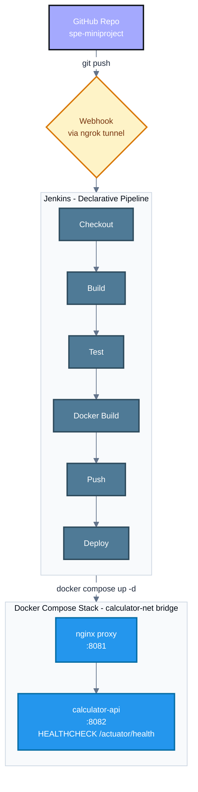

# End-to-End CI/CD Pipeline for a Calculator REST API

**CSE 816 — Software Production Engineering — Mini-Project Report**

<strong>Author:</strong> Dheeraj Murthy &nbsp;•&nbsp; <strong>Date:</strong> 23 October 2026 
<strong>Repository:</strong> <a href="https://github.com/Dheeraj-Murthy/spe-miniproject">github.com/Dheeraj-Murthy/spe-miniproject</a> 
<strong>Docker Hub:</strong> <a href="https://hub.docker.com/r/dheerajmurthy/calculator-api">hub.docker.com/r/dheerajmurthy/calculator-api</a>

### Contents

1. [Overview](#1-overview)
2. [Architecture](#2-architecture)
3. [Pipeline stage descriptions](#3-pipeline-stage-descriptions)
4. [Containerization and deployment](#4-containerization-and-deployment)
5. [Challenges faced](#5-challenges-faced)
6. [Conclusion](#6-conclusion)
7. [Appendix: Screenshots](#7-appendix-screenshots)

## 1. Overview

This report covers the implementation of a Spring Boot Calculator REST API (`com.dheeraj.miniproject`) and the full DevOps pipeline wrapped around it: **Git/GitHub** for version control, **Jenkins** for CI/CD, **Docker** for containerization, and **Docker Compose** for deployment — matching the scope defined in the CSE 816 mini-project problem statement.

The application itself is intentionally simple; the engineering is in the pipeline around it. A push to `main` is checked out, built, tested, containerized, pushed to Docker Hub, and redeployed with zero manual steps.

## 2. Architecture

Jenkins and the deployed application run as separate local services, both reachable on `localhost` but on distinct ports (`:8080` for Jenkins, `:8082`/`:8081` for the app stack) to avoid port collisions during local development and demo.

## 3. Pipeline stage descriptions

| Stage | What it does |
|---|---|
| **Checkout** | Pulls the latest `main` commit, triggered by a GitHub push webhook (`githubPush()`) tunneled to local Jenkins via `ngrok` |
| **Build** | `mvn clean package -DskipTests` — compiles and packages the executable jar; tests deliberately skipped here so Build and Test fail independently |
| **Test** | `mvn test` — 5 JUnit 5 unit tests (`CalculatorService`: add/subtract/multiply/divide/divide-by-zero) + 3 MockMvc integration tests against real `/api/v1/*` endpoints; results published from `target/surefire-reports/*.xml`, a failure stops the build before any image is built |
| **Docker Build** | Builds the multi-stage image, tagged `${BUILD_NUMBER}` and `latest` |
| **Push** | Logs into Docker Hub via the Jenkins-managed `dockerhub-credentials` entry (never hard-coded) and pushes both tags |
| **Deploy** | Sets `DOCKER_IMAGE` to the freshly pushed tag, runs `docker compose up -d --remove-orphans`, then polls `/actuator/health` until it responds |

Build status (success/failure) triggers an email from the pipeline's `post` block. Compose's own idempotent reconciliation — a re-run only recreates containers whose config changed — satisfies the re-runnable/idempotent requirement without extra scripting.

## 4. Containerization and deployment

**Dockerfile** is a two-stage build: a `maven:3.9-eclipse-temurin-22` stage compiles and packages the jar, and a slim `eclipse-temurin:22-jre-alpine` stage copies only the built jar. The runtime stage runs as a dedicated non-root `spring` user, declares `EXPOSE 8080`, and carries its own `HEALTHCHECK` hitting `/actuator/health`. `.dockerignore` excludes `target/`, `.git/`, and IDE/OS cruft to keep the build context small and caching effective.

**docker-compose.yml** brings up two services on a shared bridge network (`calculator-net`): `calculator-api` (the app, `restart: unless-stopped`, environment-driven JVM options, a Compose-level healthcheck mirroring the Dockerfile's) and `nginx` (a reverse proxy satisfying the "second component" requirement), which waits for `calculator-api`'s `service_healthy` condition before starting. A single `docker compose up -d` launches the full stack.

## 5. Challenges faced

Several real issues surfaced while wiring this up, beyond the application logic itself.

> **Spring Boot 4 package relocation**
> The generated project pulled Spring Boot 4.1.2, which renamed several test-support packages — `AutoConfigureMockMvc` moved out of the old `org.springframework.boot.test.autoconfigure.web.servlet` package into a new `org.springframework.boot.webmvc.test.autoconfigure` one. The integration test failed to compile against documentation written for Boot 3.x until the import was corrected by inspecting the actual jar contents.

> **JDK version mismatch risk between build and runtime**
> The pom targets Java 22; the Dockerfile originally used Java 21 base images for both build and runtime stages, which would have produced class files the runtime JRE couldn't load. Caught before running by verifying Java 22 Temurin images existed and switching both stages to match.

> **Port collision between Jenkins and the application**
> Homebrew's `jenkins-lts` formula hardcodes port 8080, which is also where the app's `docker-compose.yml` originally mapped `calculator-api`. Worse, `brew services restart` regenerates the launch agent plist from the formula on every restart, silently reverting a manual port change. Resolved by leaving Jenkins on its default and remapping the container's host-side port instead (`8082:8080`), which doesn't fight Homebrew's defaults.

> **Minimal PATH/JAVA_HOME under launchd**
> Homebrew starts Jenkins via `launchd`, which provides a much smaller `PATH` than an interactive shell — `mvn` and the correct `java` were invisible to pipeline `sh` steps. Fixed by pinning `JAVA_HOME` and prepending the relevant bin directories to `PATH` explicitly in the Jenkinsfile's `environment` block.

> **Missing Jenkins credential crashing the whole pipeline early**
> Before the `dockerhub-credentials` entry existed in the Jenkins credential store, the `environment { credentials(...) }` binding failed before any stage ran, which also broke the `post` blocks (lost node context, undefined `STUDENT_EMAIL`) — the real error was buried under secondary stack traces and took some digging to isolate.

> **Docker Hub token scope**
> The first access token was created as read-only, so `docker push` authenticated successfully but failed with `unauthorized: access token has insufficient scopes`. Regenerating the token with read/write scope fixed it.

> **Gmail SMTP authentication**
> Email notifications initially failed with `535 5.7.8 Username and Password not accepted` — Gmail rejects a normal account password for SMTP once 2-Step Verification is involved; it requires a generated App Password instead. A follow-up slip sent the first successful notification to the wrong address (a stale email from an unrelated context) before it was corrected to the right inbox.

> **No public endpoint for a GitHub webhook**
> Since Jenkins runs locally, GitHub's webhook delivery can't reach it directly; `ngrok http 8080` provides a temporary public tunnel, with the caveat that the free-tier URL changes on every restart and the webhook payload URL has to be re-pointed accordingly.

## 6. Conclusion

The pipeline satisfies all required stages — checkout, build, test (with published JUnit results), Docker build, push to Docker Hub via managed credentials, and Compose-based deploy with a health check — triggered automatically on a GitHub push. Most of the friction in building this came not from the application code but from the surrounding environment: tool version drift (Spring Boot 4's package moves), local port/service conflicts, and credential/scope misconfiguration — exactly the class of problem this course is meant to surface.

## 7. Appendix: Screenshots

<strong>Fig. 1:</strong> GitHub repository — source, Jenkinsfile, Dockerfile, docker-compose.yml with per-feature commit history

<strong>Fig. 2:</strong> Git commit history — incremental commits plus a feature branch (feature/report-and-docs) off main

<strong>Fig. 3:</strong> GitHub webhook configuration — payload URL tunneled through ngrok to local Jenkins, triggering on push

<strong>Fig. 4:</strong> Jenkins pipeline — full green run, all stages (Checkout SCM → Checkout → Build → Test → Docker Build → Push → Deploy → Post Actions)

<strong>Fig. 5:</strong> Jenkins Push stage — Docker Hub login and image push via the dockerhub-credentials Jenkins credential

<strong>Fig. 6:</strong> Docker Hub — calculator-api image pushed and public

<strong>Fig. 7:</strong> docker ps showing both containers running, calculator-api reporting (healthy)

<strong>Fig. 8:</strong> /actuator/health reporting all components UP

<strong>Fig. 9:</strong> Sample API response — GET /api/v1/add?a=2&amp;b=3

<strong>Fig. 10:</strong> Email notification on successful build, sent via the pipeline's post block

